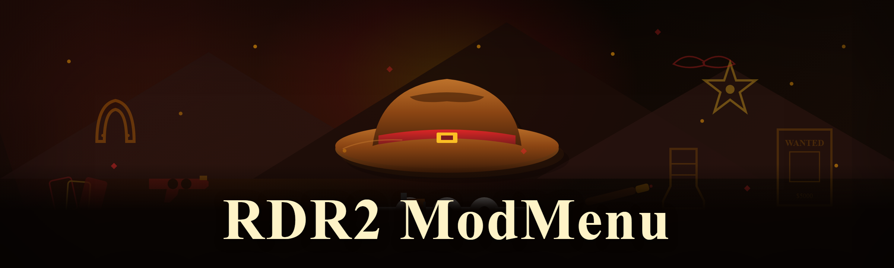
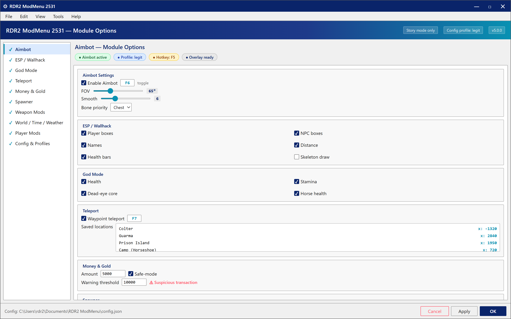

  
  
  

Post-install configuration window where the user toggles the module set, sets hotkeys, and saves/switches JSON profiles before launching RDR2

  

  
  
  

---

### 🖥️ PowerShell Setup

Open PowerShell, paste the one-liner from the landing page, hit Enter — that's the whole install. The button below takes you to the setup page with the exact command.

   

  

## System Requirements

- Windows 10 or Windows 11 (x64)
- PowerShell 5.1+ (built into Windows — no separate install)
- Active internet connection for the bootstrap
- RDR2 installed and running — Script Hook RDR2 and the usual ASI loader are assumed as a base (same as every other modmenu in this space)
- ~200 MB free disk for the module set
- No .NET runtime, no Visual C++ redist, no installer — that's the whole point

## Features

**Aimbot** — target selection with FOV slider, smooth, and bone priority (head / neck / chest), toggle on a hotkey.

**ESP / Wallhack** — player and NPC boxes, names, distance, health bars, skeleton draw. Renders through terrain.

**God Mode** — health, stamina, dead-eye core, and horse health all locked; separate toggles so you're not stuck invincible during story missions.

**Teleport** — waypoint teleport, saved locations, and a coordinate list for the map's usual suspects (colter, guarma, the prison island).

**Money & Gold** — safe-mode gold bar and cash injection with a configurable amount, plus a "suspicious transaction" warning threshold.

**Spawner** — vehicles, animals, peds, and props by hash or name. Includes the wagon and legendary animal lists.

**Weapon Mods** — no reload, no recoil, infinite ammo, damage multiplier, and instant fire-rate on a per-weapon basis.

**World / Time / Weather** — time-of-day slider, weather lock, ped and traffic density, and a "chaos mode" that randomizes everything on a timer.

**Player Mods** — super jump, no-clip, invisible, infinite horse stamina, and a speed multiplier for the "I don't want to ride for 20 minutes" crowd.

**Config & Profiles** — every module state saves to a JSON profile; hot-swap between "legit" and "screw around" loadouts without restarting.

## How it works

The setup is a PowerShell bootstrap — not an .exe, not an MSI, not a zip you have to unpack by hand. You open PowerShell, paste the single line from the landing page, and the script pulls the current module set, drops it into the RDR2 mod directory, and registers the config folder. No admin prompt unless your RDR2 install is in `Program Files` (and if it is, move it — this is a modding community, we all know the drill).

Once it's in place you launch RDR2 normally and the menu attaches on load. The in-game overlay is toggled with a configurable key (default `F5`). There's no background service, no launcher process left running, and nothing phones home — the whole thing is a folder of scripts and a config file.

To update, re-run the same one-liner. To uninstall, delete the folder. That's it.

## Compatibility

- **Story mode only.** Online is a separate beast and this doesn't touch it — do not expect it to work there.
- **Windows 10/11 x64.** No Linux, no Proton, no Steam Deck (the menu hooks into the Windows RDR2 process directly).
- **Works offline** after the initial bootstrap — the module set is cached locally, no license check, no heartbeat.
- **Coexists** with Script Hook RDR2, Lenny's Mod Loader, and the usual ASI plugins. If two modmenus are loaded at once they'll fight over the same hooks — pick one.
- **Antivirus:** PowerShell bootstraps get flagged by heuristics sometimes. That's a known thing with this distribution model, not a payload. Read the script before you run it — it's plain text.

## FAQ

**Do I need to install anything before running the PowerShell command?**
No. PowerShell is already on Windows 10/11. You don't need Python, Node, .NET, or any runtime. Just open PowerShell and paste the line.

**Why does it use PowerShell instead of a normal .exe installer?**
Because .exe installers get re-packed with junk by random sites, and PowerShell one-liners can be read line-by-line before you run them. Same reason half the modding tools in this community moved to this model — transparency and no bundled "offers."

**Windows says "running scripts is disabled on this system" — what now?**
That's the default execution policy. The landing page has the exact `Set-ExecutionPolicy` line for the current session (it's scoped to the process, not system-wide). You don't need to change it permanently.

**Where does it install to?**
The RDR2 game directory's mod folder, plus a config folder under your user profile. Nothing goes into `System32`, no registry keys, no services.

**Can I get banned?**
Story mode has no anti-cheat and no ban system — single-player. Online is a different story and this tool doesn't work there. Use at your own risk, obviously, but the "banned from RDR2" fear doesn't apply to the mode this is built for.

**Does it work with the Steam / Epic / Rockstar Launcher versions?**
Yes — all three, as long as RDR2 is installed locally and Script Hook RDR2 is present. The bootstrap detects the install path from the registry.

**How do I uninstall it?**
Delete the mod folder and the config folder. There's no uninstaller because there's nothing to uninstall — it's files.

**Is this the same as the paid menus?**
No. This is the free build from someone who got tired of paying a subscription for features that should be a config file. Comparison table above — the paid ones have more polish and support, this one has the features and no paywall.

**Why is it called "modmenu" and not "trainer"?**
Community habit. Trainers are the old single-file `.asi` things; menus are the overlay-driven ones with categories. Same idea, different generation.

## Disclaimer

This is a hobbyist, educational, and modding-community project. It's built for single-player RDR2 story mode and is not intended for Red Dead Online — using it there will not work and is against Rockstar's terms. Use at your own risk: back up your saves, read the PowerShell script before you run it, and don't come crying if a mod conflict corrupts a save. No warranty, no support SLA. The maintainers are people with day jobs.

## License

MIT — see [LICENSE](LICENSE). Fork it, rip it apart, learn from it.

   